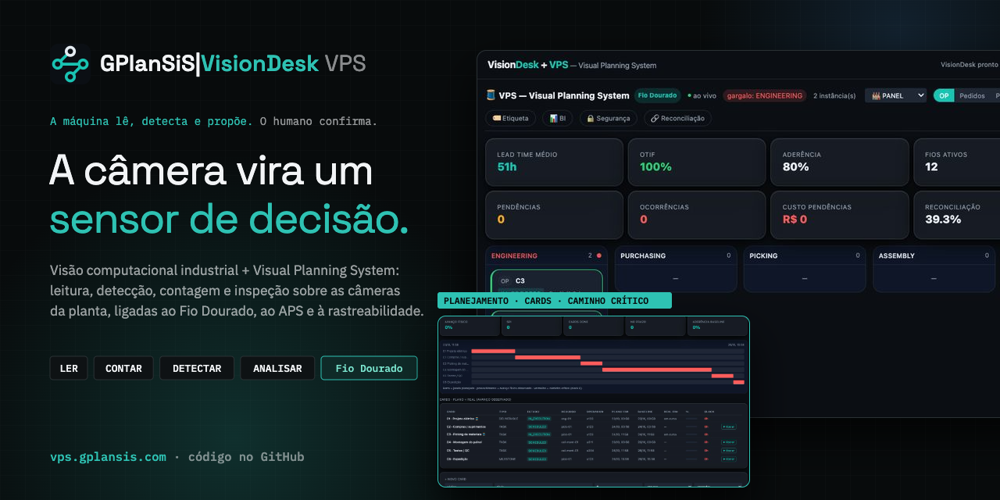
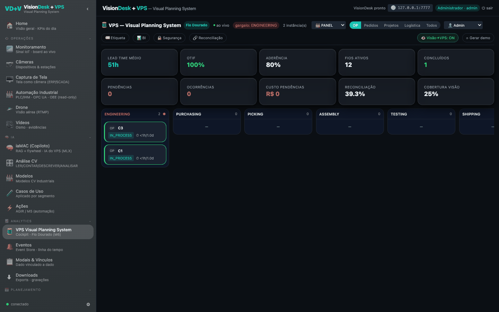
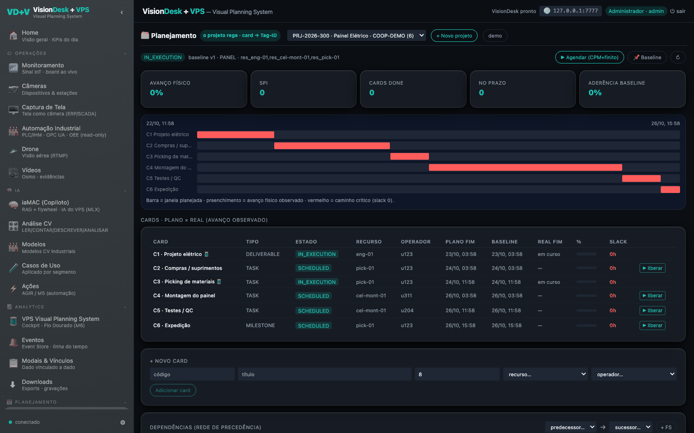
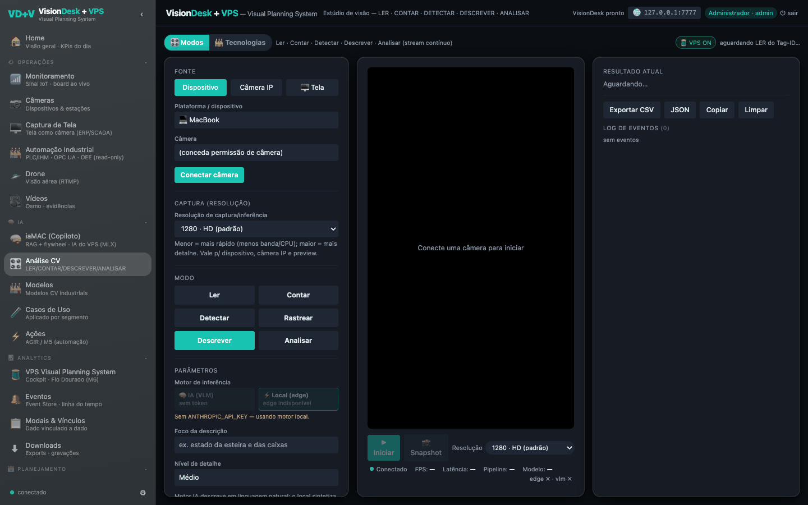
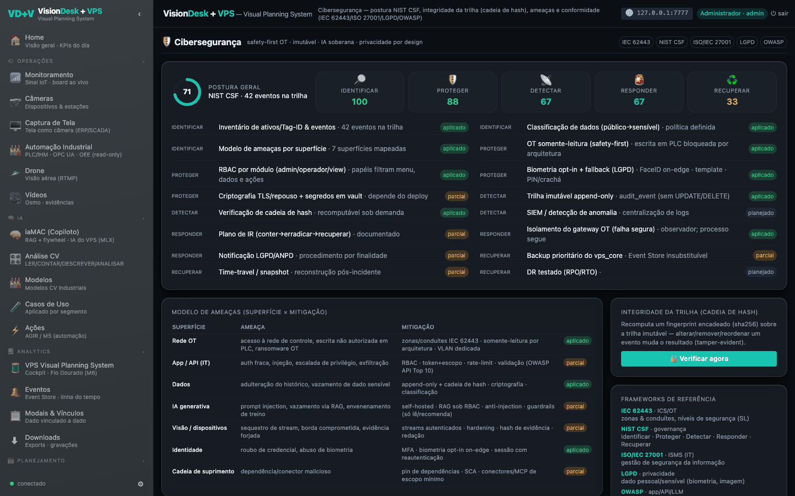
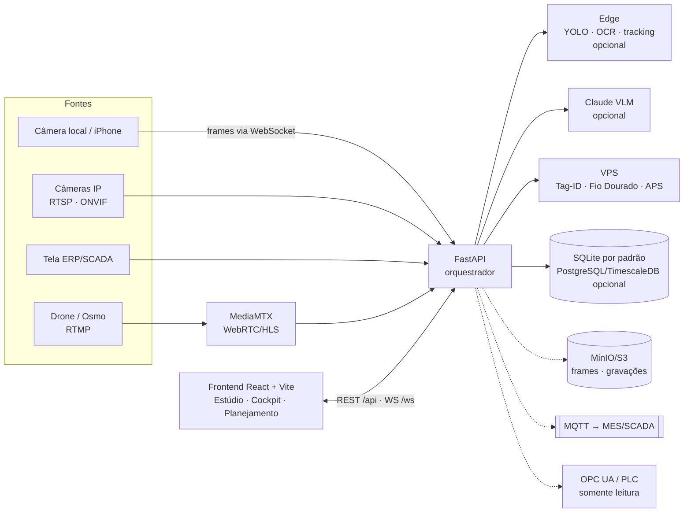

<p align="center">
  <a href="https://vps.gplansis.com"></a>
</p>

<h1 align="center">GPlanSiS|VisionDesk VPS</h1>

<p align="center">
  <strong>Visão computacional industrial + Visual Planning System: leitura, detecção, contagem, rastreio, descrição e inspeção sobre as câmeras da planta, ligadas ao Fio Dourado, ao APS e à rastreabilidade ponta a ponta.</strong><br>
  A máquina lê, detecta e propõe. O humano confirma.
</p>

<p align="center">
  <a href="https://vps.gplansis.com"></a>
  
  <a href="LICENSE"></a>
  
  
  
  
  <a href="CONTRIBUTING.md"></a>
</p>

<p align="center">
  <a href="https://vps.gplansis.com"><b>➜ Conhecer o VisionDesk VPS em vps.gplansis.com</b></a>
</p>

---

## O que é

O **VisionDesk** é um supervisório de visão computacional: transforma câmeras comuns (a do notebook, o iPhone via Continuity, câmeras IP RTSP/ONVIF, a tela de um ERP/SCADA, um drone) em **sensores**. O operador escolhe, em tempo de execução, o que a IA faz com a imagem — **ler, contar, detectar, rastrear, descrever ou analisar** — e o resultado vira evento estruturado, com trilha auditável.

O **VPS — Visual Planning System** é a camada de processo por cima da visão: cada ordem, peça ou lote recebe um **Tag-ID** e um **Fio Dourado** (a linha do tempo encadeada do item pelas fases engenharia → compras → separação → montagem → testes → expedição → faturamento). A visão confirma o que aconteceu; pendências e ocorrências aparecem no cockpit; o planejamento (cards, caminho crítico e APS de capacidade finita) usa o que foi observado.

Princípios que o código segue:
- **A IA propõe, o humano confirma** — nada da visão escreve em PLC ou no processo sem confirmação (a integração OT é *read-only*).
- **Edge primeiro, degradação graciosa** — modelos locais (YOLO, OCR, classificadores) quando instalados; sem eles, o orquestrador cai no VLM (Claude); sem chave de API, os modos locais continuam.
- **Privacidade por padrão (LGPD)** — frames **não** são gravados por padrão; biometria é opt-in, com template local (descritor LBP), nunca a foto.

## Funcionalidades

### Visão (Estúdio · Análise CV)
- **6 modos**: Ler (OCR estruturado + regex), Contar (detecção + tracking com linha/zona), Detectar, Rastrear, Descrever (linguagem natural) e Analisar (OK/NOK com critérios).
- **Motor IA ↔ Local** por módulo: Claude (VLM, *structured outputs*) ou edge (YOLO11/RT-DETR via Ultralytics, OCR Apple Vision no macOS, CNN MobileNetV3 / ViT, anomalia não supervisionada).
- **ROI** desenhada sobre o vídeo (retângulo, linha, zona), snapshot ou fluxo contínuo com backpressure, exportação CSV/JSON.
- **Fontes**: dispositivo local, **câmera IP** (descoberta ONVIF WS-Discovery + varredura de portas na sub-rede privada, URLs RTSP candidatas), **captura de tela** (ERP/SCADA como câmera), **drone/Osmo** via RTMP → MediaMTX.

### VPS — Visual Planning System
- **Cockpit Fio Dourado**: KPIs (lead time, OTIF, aderência, pendências, ocorrências, custo de pendências, taxa de reconciliação, cobertura de visão), quadro por fase e gargalo.
- **Tag-ID e etiquetas** com QR (gerador de tags e etiquetas, leitura na estação), **reconciliação** com documentos do ERP.
- **Visual Planning**: projetos, EAP, cards, dependências, linha de base, caminho crítico e plano × real.
- **APS** de capacidade finita: recursos, regras de sequenciamento, cenários, CTP/ATP (promessa de prazo), comparação de regras.
- **Event Store** (linha do tempo de eventos) e **Modais & Vínculos** (dado vinculado a dado).

### Ativos e integração
- **Automação industrial** *read-only*: PLC/IHM, OPC UA, OEE e reconciliação PLC × visão × ERP.
- **Termografia** (hotspot, ΔT, tendência) e **metrologia** (medição dimensional, tolerância, Cpk).
- **Operadores** (papéis, skills, estações), **reconhecimento facial** opcional para login, **matriz de câmeras e dispositivos**.
- **Ações (AGIR)**: regras no-code que disparam notificações e integrações; eventos para **MQTT** (MES/SCADA), métricas **Prometheus**, gravações por detecção.
- **iaMAC (copiloto)**: RAG sobre a documentação do sistema com LLM local via MLX (Apple Silicon), opcional.

### Administração
- Acesso & regras (usuários, papéis, PIN/crachá, FaceID), **Cibersegurança** (postura NIST CSF, IEC 62443, ISO/IEC 27001, LGPD, OWASP, verificação da cadeia de hash da trilha), **Testes E2E** (demo ponta a ponta do sistema), **Bases** (status de cada armazenamento) e **Manual**.

## Telas

| Cockpit Fio Dourado | Visual Planning |
|---|---|
|  |  |
| **Análise CV (Estúdio)** | **Cibersegurança** |
|  |  |

> Capturas de uma instância local com os dados de demonstração do próprio sistema (`/api/vps/seed`, `/api/vps/e2e/run`, `/api/vps/planning/seed`) — operadores, clientes e ordens fictícios.

## Arquitetura



Tudo o que é tracejado é opcional: sem `DATABASE_URL` o sistema usa SQLite; sem S3, o disco; sem broker, *no-op*.

## Stack

| Camada | Tecnologia |
|---|---|
| Backend | Python 3.12, FastAPI, Pydantic v2 + pydantic-settings, WebSocket, Pillow, httpx, segno (QR) |
| IA | SDK `anthropic` (Claude vision); edge opcional: Ultralytics YOLO11/RT-DETR, OpenCV, PyTorch/torchvision, Apple Vision (macOS), MLX |
| Dados | SQLite (padrão); opcional PostgreSQL 16 + TimescaleDB, MinIO/S3 |
| Integração | MQTT (Mosquitto), MediaMTX (WebRTC/HLS/RTMP), OPC UA, Prometheus |
| Frontend | React 18, TypeScript, Vite 5, Tailwind CSS 3, zustand |
| Site | página de apresentação estática em `site/` (a raiz de vps.gplansis.com) |

## Como rodar localmente

Requisitos: **Python 3.12**, **Node 18+**. Chave da Anthropic opcional (sem ela, os modos via VLM ficam indisponíveis e o resto funciona).

```bash
git clone https://github.com/SSBianchiplan/vps.git
cd vps
cp .env.example .env            # preencha ANTHROPIC_API_KEY se quiser os modos via VLM

# backend (porta 8200)
make backend                    # cria backend/.venv, instala o core e sobe o uvicorn

# frontend (porta 7777, proxy de /api e /ws para o backend)
make frontend                   # npm install + vite
```

Abra <http://localhost:7777>. No primeiro acesso o sistema pede para **criar o administrador** (nome + PIN). Para ter conteúdo no cockpit e no planejamento, carregue os dados de demonstração (fictícios):

```bash
curl -X POST localhost:8200/api/vps/seed
curl -X POST localhost:8200/api/vps/e2e/run
curl -X POST localhost:8200/api/vps/planning/seed
curl -X POST localhost:8200/api/vps/operators/seed
```

- **Câmera fora de `localhost`** (celular pela rede): o navegador exige HTTPS — coloque `certs/key.pem` e `certs/cert.pem` em `frontend/` (não versionados) e o Vite sobe em HTTPS.
- **Caminho edge** (YOLO/OCR/tracking): `make install-edge`. Os pesos (ex.: `yolo11n.pt`, ~5 MB) **não** estão no repositório: o Ultralytics baixa automaticamente na primeira execução, ou aponte `VISIONDESK_YOLO_WEIGHTS` para um arquivo seu.
- **Stack de escala** (Postgres/TimescaleDB, MinIO, MQTT, MediaMTX): `docker compose up -d` e mescle `.env.docker.example` no seu `.env`. Credenciais do compose são só de desenvolvimento.
- **Testes**: `make test` (59 testes; 1 depende do caminho edge com OpenCV para decodificar QR).

## Estrutura de pastas

```
vps/
├── backend/
│   ├── app/
│   │   ├── main.py           # FastAPI: rotas REST, WebSocket, CORS, guarda opcional por API key
│   │   ├── api/              # rotas (infer, cameras, vps, face, metro, thermo, automation, iamac…) + ws
│   │   ├── orchestrator/     # roteamento edge / VLM / híbrido
│   │   ├── pipelines/        # um pipeline por modo, com fallback edge → VLM
│   │   ├── inference/        # vlm/ (Claude) e edge/ (YOLO, OCR, classificadores, anomalia)
│   │   ├── vps/              # Tag-ID, Fio Dourado, APS, planejamento, reconciliação, RBAC, LGPD
│   │   ├── discovery/        # ONVIF, varredura de rede privada, PTZ, câmeras salvas
│   │   ├── automation/       # OT read-only (PLC/IHM, OPC UA, OEE)
│   │   ├── biometrics/       # reconhecimento facial local (LBP), opt-in
│   │   ├── db/ · storage.py · audit*.py · integration/ · notify/ · actions/ · iamac/ …
│   ├── tests/                # pytest
│   ├── scripts/              # seed de teste (PostgreSQL) e banco de auditoria
│   └── requirements*.txt     # core, edge (opcional) e dev
├── frontend/                 # React + Vite + Tailwind (src/components/views = módulos)
├── site/index.html           # página de apresentação (raiz do site)
├── ops/                      # mediamtx.yml e mosquitto.conf de desenvolvimento
├── scripts/                  # run-backend.sh, run-frontend.sh, export_model.py, synth_data.py
├── docs/README-v2-original.md
├── docker-compose.yml        # stack de escala para desenvolvimento
├── Makefile
├── .env.example · .env.docker.example
```

## Variáveis de ambiente

Prefixo `VISIONDESK_` (lidas de `.env` na raiz ou em `backend/`). Modelo completo em [`.env.example`](.env.example) e [`.env.docker.example`](.env.docker.example).

| Variável | Uso | Padrão |
|---|---|---|
| `ANTHROPIC_API_KEY` | Chave da Anthropic para os modos via VLM | vazia (VLM desligado) |
| `VISIONDESK_CLAUDE_MODEL` | Modelo do Claude | `claude-opus-4-8` |
| `VISIONDESK_DB_PATH` | Banco SQLite | `./data/visiondesk.db` |
| `VISIONDESK_PERSIST_FRAMES`, `VISIONDESK_FRAMES_DIR` | Gravar frames (opt-in, LGPD) | `false`, `./data/frames` |
| `VISIONDESK_HOST`, `VISIONDESK_PORT` | Servidor | `0.0.0.0`, `8200` |
| `VISIONDESK_CORS_ORIGINS` | Origens do frontend (CSV) | localhost 5173/7777 |
| `VISIONDESK_API_KEY` | Se definida, exige `X-API-Key` em `/api/*` | vazia |
| `VISIONDESK_YOLO_WEIGHTS`, `VISIONDESK_YOLO_CONF`, `VISIONDESK_EDGE_DEVICE` | Caminho edge | `yolo11n.pt`, `0.35`, `mps` |
| `VISIONDESK_DATABASE_URL` | PostgreSQL/TimescaleDB | vazia (SQLite) |
| `VISIONDESK_S3_ENDPOINT`, `VISIONDESK_S3_BUCKET`, `AWS_ACCESS_KEY_ID`, `AWS_SECRET_ACCESS_KEY` | Object store | vazios |
| `VISIONDESK_MQTT_URL`, `VISIONDESK_MQTT_TOPIC` | Eventos para MES/SCADA | vazios |
| `VISIONDESK_OPCUA_URL` | OPC UA (leitura) | vazia |
| `VISIONDESK_RESTREAM_BASE`, `VISIONDESK_RESTREAM_API_BASE` | MediaMTX (WebRTC/HLS e API) | `:8889`, `:9997` |
| `VISIONDESK_AUDIT_PG`, `VISIONDESK_AUDIT_PG_DSN` | Espelhar a trilha de auditoria em PostgreSQL (`1` liga) | desligado, `dbname=visiondesk_audit` |
| `VISIONDESK_MODELS_DIR` | Cache de modelos do iaMAC/Hugging Face | vazio (padrão do HF) |
| `VISIONDESK_VPS_*` | VPS: segmento, custo/hora de pendência, desfoque LGPD, retenção, papel padrão | ver `backend/app/config.py` |
| `VITE_API_BASE`, `VITE_WS_URL` | Frontend apontando para outro backend | vazios (proxy do Vite) |

## Estado e limites desta publicação

- O código aqui é a versão **VisionDesk v2 / VPS 0.1** (junho–julho de 2026). A aplicação em produção em <https://vps.gplansis.com/app> recebeu evoluções depois disso (por exemplo, estruturação de produto/BOM no PCP, perfis operacionais e biblioteca de documentos) que **ainda não estão neste repositório**.
- O RBAC do VPS é **demonstrativo**: em desenvolvimento o papel padrão é `Admin` (`VISIONDESK_VPS_DEFAULT_ROLE`). Para expor na internet, defina `VISIONDESK_API_KEY`, ponha o backend atrás de um proxy com TLS e troque o papel padrão.
- `ops/mosquitto.conf` e `ops/mediamtx.yml` são de **desenvolvimento** (broker anônimo, API do MediaMTX aberta).

## Contribua

O VisionDesk VPS quer provar que câmeras comuns, bem orquestradas, viram sensores confiáveis para o chão de fábrica — sem tirar o humano da decisão. **Toda ajuda conta.**

**Por onde começar (boas primeiras issues):**
- 🧪 **Testes**: cobrir `vps/` (APS, planejamento, reconciliação) e as rotas da API; marcar como `edge` os testes que dependem de OpenCV/YOLO.
- 🛠️ **CI no GitHub Actions**: `pytest` do core, `tsc --noEmit` e `vite build` do frontend. Primeiro passo: hoje o `npm run typecheck` acusa a falta de `@types/node` para o `vite.config.ts`.
- 📷 **Câmeras**: testar descoberta ONVIF/RTSP em mais fabricantes e documentar as URLs que funcionam (sem credenciais!).
- 🔐 **Segurança**: autenticação real no lugar do papel padrão, rate-limit, cabeçalhos de segurança; revisão LGPD da biometria.
- 🧠 **Modelos edge**: exportação ONNX/CoreML (`scripts/export_model.py`), novos classificadores e benchmarks por hardware.
- 🌐 **Internacionalização**: hoje a interface é pt-BR.
- 📚 **Documentação**: tutoriais por caso de uso (contagem em esteira, leitura de OP, inspeção OK/NOK).

Leia o [guia de contribuição](CONTRIBUTING.md), abra uma [issue](../../issues/new/choose) para combinar a ideia e mande seu pull request. Siga o [código de conduta](CODE_OF_CONDUCT.md). Encontrou uma falha de segurança? Veja a [política de segurança](SECURITY.md) — não abra issue pública.

## Licença

Código próprio sob a **[licença MIT](LICENSE)** — Copyright (c) 2026 GPlanSiS.

Nenhum código de terceiros está copiado no repositório; as dependências são instaladas por `pip`/`npm` e mantêm suas licenças. Atenção ao caminho **edge opcional**: o pacote **Ultralytics (YOLO)** e seus pesos são distribuídos sob **AGPL-3.0** (ou licença comercial da Ultralytics) — avalie isso antes de usar o caminho edge em produto fechado. Demais dependências: FastAPI, Pydantic, uvicorn, httpx, anthropic, React, Vite, Tailwind, zustand (MIT/BSD), Pillow (HPND), segno (BSD), OpenCV e boto3 (Apache-2.0), PyTorch/torchvision (BSD), MLX (MIT), psycopg (LGPL-3.0). As fontes da página de apresentação (Space Grotesk, IBM Plex) são carregadas do Google Fonts (SIL OFL 1.1).

## Créditos

Desenvolvido pela **[GPlanSiS|Group](https://gplansis.com)** · contato: [contato@gplansis.com](mailto:contato@gplansis.com)

<p align="center"><a href="https://vps.gplansis.com"><b>vps.gplansis.com</b></a></p>
